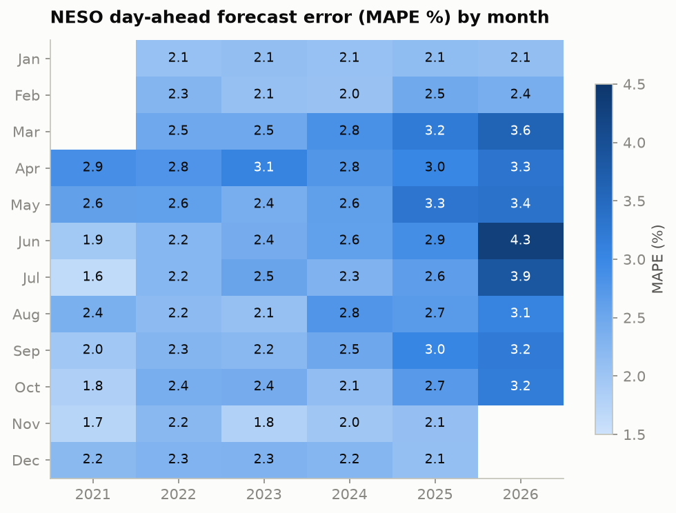
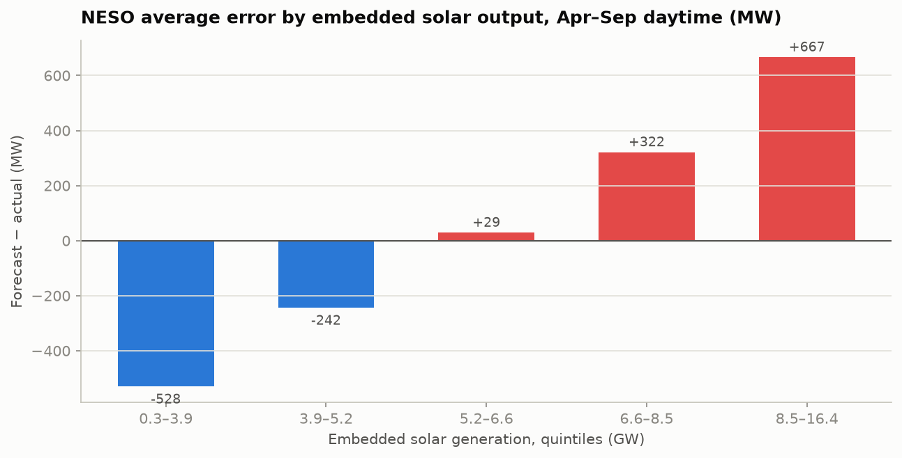

# UK Energy Intelligence
**Electricity demand forecasting, analytics and decision support for Great Britain**

> 🚧 Work in progress — Phase 4 of 12 (exploratory analysis)

## The question
Can we forecast Great Britain's half-hourly electricity demand accurately enough
to beat a simple baseline, compete with NESO's own day-ahead forecast, and turn
the forecast into better operating decisions?

## Key findings so far
Full analysis: [`notebooks/01_eda.ipynb`](notebooks/01_eda.ipynb)

1. **NESO's day-ahead forecast is getting worse — and it's a solar problem.** Average error rose from 2.1% (2021) to 3.2% (2026).
   Winter accuracy is unchanged; the deterioration is at sunny spring/summer middays (midday error +27%, 2022 → 2025),
   and NESO's bias flips sign with solar output (−530 MW on dull days, +670 MW on the sunniest).
2. **Rooftop solar hides demand.** Each extra 1 GW of embedded solar removes ~0.7 GW of midday grid demand.
3. **Grid demand is falling faster than consumption.** Like-for-like, ND fell 11.6% from 2019 to 2026, underlying demand only 5.7%,
   while embedded solar capacity grew 85%.
4. **Cold drives demand:** below 15 °C, each 1 °C colder adds ~840 MW. Weekends are 10–12% lower, bank holidays 15%.
5. **COVID-19 lockdown cut demand by 18%** (23 Mar – 10 May 2020 vs 2019).




## Data sources
| Dataset | Source | Used for |
|---|---|---|
| Historic half-hourly demand (ND, TSD, embedded solar/wind) | [NESO Data Portal](https://www.neso.energy/data-portal/historic-demand-data) | Target variable, EDA |
| Day-ahead demand forecasts | NESO Data Portal | Industry benchmark |
| Historical weather + historical weather *forecasts* | [Open-Meteo](https://open-meteo.com/) | Features (forecasts used for fair benchmarking) |
| System / imbalance prices | [Elexon Insights API](https://developer.data.elexon.co.uk/) | Costing forecast errors |

## Project structure
```
uk-energy-intelligence/
├── app/                 # Streamlit decision simulator (Phase 10)
├── dashboards/powerbi/  # Power BI report, DAX measures, theme + build guide (Phase 5)
├── data/
│   ├── raw/             # Downloaded files, never edited (git-ignored)
│   ├── processed/       # Cleaned data (git-ignored)
│   └── external/        # Weather, prices (git-ignored)
├── models/              # Saved models (git-ignored)
├── notebooks/           # EDA and experiments
├── reports/figures/     # Charts for the README and reports
├── sql/                 # Schema and analytical queries (DuckDB)
├── src/
│   ├── config.py        # Paths and constants
│   ├── data/            # Download, ETL and validation scripts
│   ├── features/        # Feature engineering
│   └── models/          # Training and evaluation
└── tests/
```

## Getting started
```bash
python -m venv .venv
.venv\Scripts\activate          # Windows  (macOS/Linux: source .venv/bin/activate)
pip install -r requirements.txt

python -m src.data.download_neso             # NESO demand, 2019 onwards
python -m src.data.download_neso_forecasts   # NESO day-ahead forecasts (benchmark)
python -m src.data.download_weather --mode actual
python -m src.data.download_weather --mode forecast
python -m src.data.validate                  # raw-file checks
python -m src.data.build_database            # build data/energy.duckdb
python -m pytest -v                          # unit + data-quality tests
python -m src.data.export_powerbi            # CSVs for Power BI (see dashboards/powerbi/README.md)
```

## Roadmap
- [x] 1. Environment and GitHub setup
- [x] 2. Download official datasets
- [x] 3. SQL database (DuckDB) and ETL
- [x] 4. Data quality and EDA
- [ ] 5. Power BI dashboard
- [ ] 6. Baseline forecasts (seasonal naive)
- [ ] 7. Gradient boosting with quantile forecasts (P10/P50/P90)
- [ ] 8. Evaluation vs baseline and NESO day-ahead
- [ ] 9. Forecast-to-decision simulator
- [ ] 10. Streamlit deployment
- [ ] 11. Documentation
- [ ] 12. Interview preparation

## Data warehouse (DuckDB)
| Layer | Tables | Built by |
|---|---|---|
| raw | `raw_demand`, `raw_neso_forecast`, `raw_weather`, `dim_city` | `src/data/build_database.py` |
| staging | `stg_demand`, `stg_neso_forecast`, `stg_weather_gb_hourly`, `stg_weather_gb_hh` | `sql/01_staging.sql` |
| mart | `fact_demand_hh` (one row per half-hour), `v_daily_demand` | `sql/02_marts.sql` |
| analysis | `v_fact_enriched`, `v_annual_summary`, `v_daily_peaks`, `v_neso_error_monthly` | `sql/03_analysis.sql` |

## Methodology notes
- **No leakage:** chronological train/validation/test splits only.
- **Fair benchmark:** when comparing with NESO's day-ahead forecast, the model only uses
  weather *forecasts* available at the time, not actual observed weather.
- **Demand definition:** NESO's ND/TSD exclude embedded solar and wind, so sunny days
  lower recorded demand; this is modelled explicitly.
- **Target:** ND (national demand). NESO's own benchmark outturn matches ND within ~55 MW on average.
- **Time:** settlement periods are converted to UTC (46 periods on spring clock-change days, 50 in autumn).
  NESO's benchmark file repeats the extra autumn hour under the same period numbers, so those 6 days
  are excluded from the benchmark comparison.
- **Weather:** population-weighted average of 6 GB cities, hourly values interpolated to half-hours.
  Forecast weather archive is complete from 6 March 2024, which sets the start of the fair test window.
- **Known data quirks:** NESO uses three date formats across years (handled explicitly); 46/50 settlement periods on clock-change days; COVID-19 demand
  drop in 2020; long-term downward trend in transmission demand.

## Results
_Coming in Phase 8._

## Author
Tej
